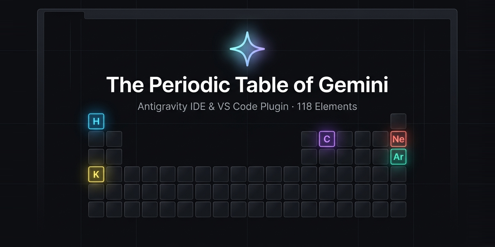

# The Periodic Table of Gemini — Google Antigravity 插件



> 将 Google Gemini 网页端隐藏彩蛋 **The Periodic Table of Gemini** 移植到 **Google Antigravity IDE**（同时兼容 Visual Studio Code），在编辑器中随时浏览全部 **118 个化学元素**的中英双语科普与 **5 大 Gemini 彩蛋模型**。

---

## 直接下载

| 文件名 | 类型 | 说明 | 仓库直链 |
| :--- | :--- | :--- | :--- |
| `periodic-table-of-gemini-1.0.0.vsix` | VSIX 插件包 | 零依赖离线安装包，可直接导入 Antigravity IDE / VS Code | [下载 .vsix 安装包](https://github.com/OriginJinMu/periodic-table-of-gemini-antigravity-plugin/raw/main/periodic-table-of-gemini-1.0.0.vsix) |
| `source/` | 插件完整源码 | 包含 `package.json`、`extension.js`、`media/` 全部源码与数据 | [浏览插件源码目录](./source) |

---

## 核心功能

* **完整 118 元素交互周期表**：采用标准 18 列布局（含底部镧系 57–71 与锕系 89–103），支持鼠标悬停实时预览、点击锁定详情，以及 **50 Sn（Tin · 锡）** 截图原文条目（`Bronze age - CuSn` / `"Just 12% tin in copper launched the Bronze Age — Latin 'stannum' gives Sn."`）。
* **5 大 Gemini 彩蛋模型高亮**：精准复刻网页端彩蛋色块，顶部提供 5 模型快捷切换条，支持一键固定到 IDE 状态栏或复制模型名称。
* **周期表 / 清单双视图与即时搜索**：可在标准周期表与卡片清单间切换，支持「✦ 仅 5 彩蛋」筛选，按 `/` 可按原子序数、元素符号、中英文名或模型名实时过滤。
* **状态栏常驻 & 侧边栏联动**：右下角状态栏显示当前选中的元素或 Gemini 模型，点击即可唤出主面板；左侧 Activity Bar 同步提供紧凑侧边栏视图与「展开大图」入口。
* **中英双语与 IDE 主题自适应**：支持「中英双语 / 仅中文 / EN Only」循环切换，默认自动跟随 Antigravity IDE 或 VS Code 当前配色主题，也可手动切换浅色或深色模式。
* **纯离线零依赖**：全部 118 条元素数据、样式与脚本均打包在本地 `.vsix` 内，无需联网或额外安装 npm 依赖。

---

## 5 大 Gemini 彩蛋模型对照

依据 [OriginJinMu/periodic-table-of-gemini](https://github.com/OriginJinMu/periodic-table-of-gemini)、[Valyu 模型对比](https://www.valyu.ai/blogs/gemini-4-neon-vs-carbon-vs-hydrogen-vs-argon) 与 [r/IndiaTech 彩蛋讨论](https://www.reddit.com/r/IndiaTech/comments/1y2jr42/google_turned_geminis_model_picker_into_a/)，插件中高亮了以下 5 个彩蛋元素：

| 序数 | 符号 | 元素名称 | 对应彩蛋模型 | 快捷键 | 定位与特点 |
| :---: | :---: | :--- | :--- | :---: | :--- |
| 1 | **H** | Hydrogen · 氢 | **Gemini 4 Hydrogen** | `1` | 快速日常主力与高频编码，约 165–170 tok/s，API `$1.50/$7.50` |
| 6 | **C** | Carbon · 碳 | **Gemini 4 Carbon** | `2` | 深度推理与长周期任务旗舰，标准价 `$4/$20`（11 月促销 `$2/$10`） |
| 10 | **Ne** | Neon · 氖 | **Gemini 4 Neon** | `3` | 复杂工程、代码智能体与科学工作中坚，约 110 tok/s，API `$3/$15` |
| 18 | **Ar** | Argon · 氩 | **Gemini 4 Argon** | `4` | Carbon 高效版，单轮消耗更低，标准价 `$4/$20`（11 月促销 `$2/$10`） |
| 19 | **K** | Potassium · 钾 | **Nano Banana** | `5` | 图像模型彩蛋，因香蕉富含钾元素而被藏在 K 的位置 |

---

## 安装指南

### 方式一：在 Google Antigravity IDE 中图形界面安装（推荐）

1. 从本仓库下载 [periodic-table-of-gemini-1.0.0.vsix](https://github.com/OriginJinMu/periodic-table-of-gemini-antigravity-plugin/raw/main/periodic-table-of-gemini-1.0.0.vsix)。
2. 打开 **Google Antigravity IDE**，按 `Ctrl+Shift+X`（macOS 为 `Cmd+Shift+X`）打开扩展视图。
3. 点击右上角 `...` 菜单，选择 **Install from VSIX...** 并选中下载的 `.vsix` 文件。
4. 如侧边栏或状态栏未立即刷新，按 `Ctrl+Shift+P` 执行 `Developer: Reload Window`。

### 方式二：命令行一键安装

在终端或 Windows PowerShell 中执行：

```bash
antigravity --install-extension periodic-table-of-gemini-1.0.0.vsix
```

如果是在安装了 [Google Antigravity 官方扩展](https://antigravity.google/docs/ide/extensions/vscode/) 的 **VS Code** 中使用，将命令替换为：

```bash
code --install-extension periodic-table-of-gemini-1.0.0.vsix
```

---

## 快捷键与命令一览

| 触发方式 | 快捷键 / 命令名称 | 功能说明 |
| :--- | :--- | :--- |
| 打开主周期表面板 | `Ctrl+Alt+G`（macOS `Cmd+Alt+G`） | 在主编辑区打开完整 18 列交互周期表 |
| 状态栏按钮 | 点击右下角 `$(sparkle)` 状态栏项 | 随时唤出周期表并显示当前固定元素/模型 |
| 侧边栏图标 | 点击左侧 Activity Bar 元素周期表图标 | 在侧边栏快速浏览或筛选元素 |
| 快速检索 | `Periodic Table of Gemini: Quick Pick Element / Gemini Model` | 通过命令面板模糊搜索 118 元素或 5 大模型 |
| 随机科普彩蛋 | `Periodic Table of Gemini: Surprise Me (Random Element Fact)` | 随机弹出一条元素科普并支持跳转查看 |
| 面板内键盘操作 | `←` / `→`、`1`–`5`、`/`、`Esc` | 切换相邻元素、速切 5 大彩蛋、聚焦/清空搜索 |

---

## 配置项

在 Antigravity IDE / VS Code 设置（`settings.json`）中可自定义以下选项：

```json
{
  "periodicTableOfGemini.defaultLanguage": "bilingual",
  "periodicTableOfGemini.showStatusBar": true
}
```

* `periodicTableOfGemini.defaultLanguage`：默认展示语言，可选 `"bilingual"`（中英双语）、`"zh"`（仅中文）、`"en"`（仅英文）。
* `periodicTableOfGemini.showStatusBar`：是否在底部状态栏常驻显示彩蛋入口（默认 `true`）。

---

## 源码目录结构

```text
source/
├── package.json          # 扩展清单、命令、快捷键、侧边栏视图与配置声明
├── extension.js          # 扩展宿主入口（状态栏、Webview 面板、侧边栏与持久化状态）
├── README.md             # 插件内置说明文档
├── LICENSE               # MIT 开源协议
└── media/
    ├── elements.json     # 全部 118 个元素中英双语数据、网格坐标与 5 模型元数据
    ├── webview.css       # 响应式布局、IDE 主题变量适配与 5 模型彩蛋配色
    ├── webview.js        # 周期表/清单双视图渲染、搜索过滤与键盘导航逻辑
    ├── icon.png          # 128×128 扩展图标
    └── activity-icon.svg # Activity Bar 单色矢量图标
```

---

## 致谢与参考来源

* 原始彩蛋整理与网页版项目：[OriginJinMu/periodic-table-of-gemini](https://github.com/OriginJinMu/periodic-table-of-gemini)（[在线预览](https://originjinmu.github.io/periodic-table-of-gemini/)）
* Gemini 网页端彩蛋社区讨论：[r/GeminiAI](https://www.reddit.com/r/GeminiAI/comments/1y2ga79/gemini_easter_egg_i_bet_you_havent_held_down_on/) · [r/IndiaTech](https://www.reddit.com/r/IndiaTech/comments/1y2jr42/google_turned_geminis_model_picker_into_a/)
* Gemini 4 模型定位参考：[Valyu 模型对比](https://www.valyu.ai/blogs/gemini-4-neon-vs-carbon-vs-hydrogen-vs-argon)
* Google Antigravity 扩展文档：[Google Antigravity Docs](https://antigravity.google/docs/ide/extensions/vscode/)

---

## 作者与共同创作者 (Authors & Contributors)

| 头像 | 角色 | 名称 | 主页 / 联系 |
| :---: | :--- | :--- | :--- |
|  | **作者 (Author)** | **OriginJinMu** | [@OriginJinMu](https://github.com/OriginJinMu) |
|  | **共同创作者 (Co-author)** | **Gemini-Neon** | `antigravity@google.com` |
